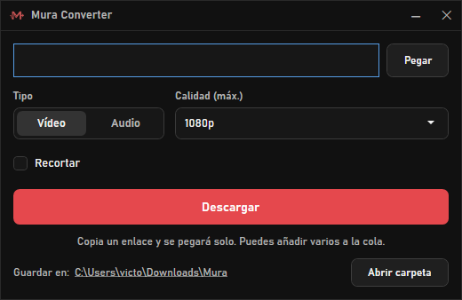

<p align="center"></p>

# 🎧 Mura Converter — Simple Media Converter
[](https://opensource.org/licenses/MIT)

A simple desktop media converter built with C# and WPF.  
Paste a link from YouTube, TikTok, Instagram, SoundCloud and many more sites, and download the video or just the audio in the format you need.

<p align="center"></p>

> ⚠️ **Legal Disclaimer**

This project was created for **educational and personal use only**.  
I do **not endorse** or take **any responsibility** for how others use this tool, especially if used to violate YouTube’s Terms of Service or download copyrighted content without permission.

**Use at your own risk.**

---

## 🚀 Features

- Video (MP4, MKV or WebM, up to 4K) or audio (MP3, M4A, Opus or lossless WAV)
- Preview before downloading: thumbnail, title, channel and duration
- Download queue: paste several links in a row and they download one after another
- Whole playlists in one go, saved into their own numbered folder
- Trim: pick a section with a two-handle bar or type the times (e.g. 1:20 → 2:45); only that part is downloaded
- Works with YouTube, TikTok, Instagram, X, Twitch, SoundCloud, Vimeo and [many more](https://github.com/yt-dlp/yt-dlp/blob/master/supportedsites.md)
- Auto-pastes copied links (on launch and when the window gets focus); drag & drop; Enter to download
- Windows notification when a download finishes in the background
- Explorer right-click menu: **"Descargar enlace copiado con Mura"** downloads the copied link straight into that folder, without opening the window
- Powered by bundled [yt-dlp](https://github.com/yt-dlp/yt-dlp) + FFmpeg, auto-updated daily so it keeps working when YouTube changes
- MP4 prefers H.264 + AAC so files play everywhere; MKV/WebM keep the best streams as-is. No re-encoding (fast)
- Remembers your format, quality and output folder (default `Downloads\Mura`)

---

## 📦 Install

Download `MuraConverter-Setup-x.y.z.exe` from [Releases](https://github.com/VitomDev/Mura-Converter/releases/latest) and run it.

> 🧰 **Recommended:** install it with [Vitool Box](https://github.com/VitomDev/Vitool-Box), which keeps all VitomDev apps in one place and installs or removes them with a switch.

- Per-user install, no admin rights and no .NET needed

Optional: installing [Deno](https://deno.com) (`winget install DenoLand.Deno`) lets yt-dlp see every YouTube format; it is picked up automatically.

---

## 🔧 Build

Requirements: .NET 10 SDK and Inno Setup 6 (`winget install JRSoftware.InnoSetup`).

```powershell
.\build.ps1
```

It downloads yt-dlp and FFmpeg into `Mura Converter/tools/` if missing, publishes the app and writes the installer to `dist/`.

---

## 📚 Dependencies

- [yt-dlp](https://github.com/yt-dlp/yt-dlp) — downloading from YouTube and many other sites
- [FFmpeg](https://ffmpeg.org) — merging and converting audio and video

See [third-party notices](THIRD-PARTY-NOTICES.md) for licenses.

---

## 🪟 Compatibility

Windows 10 and Windows 11, 64-bit.

---

## 🧪 Project Status

✅ Stable.  
This project is fully functional as-is and ready to use.
Future updates to improve features or the interface are not ruled out.

---

## 📄 License

[MIT](LICENSE) © VitomDev

---

## 📲 Contact

Feel free to reach out or follow me:

- 🐙 GitHub: [@VitomDev](https://github.com/VitomDev)
- 🐦 Twitter/X: [@VitomDev](https://twitter.com/VitomDev)
- 🎮 Twitch: [@VitomDev](https://www.twitch.tv/VitomDev)
- 💼 LinkedIn: [VitomDev](https://www.linkedin.com/in/víctor-escós-batalla/)
